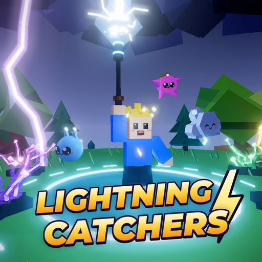
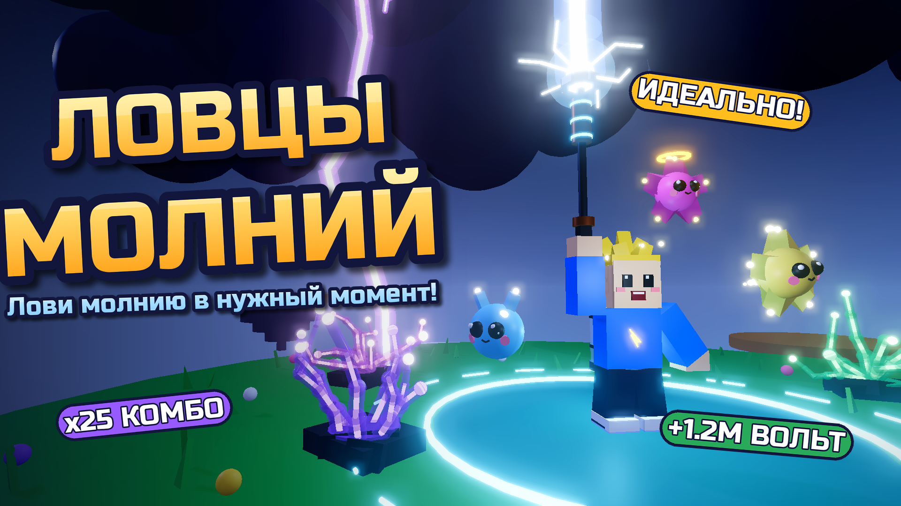
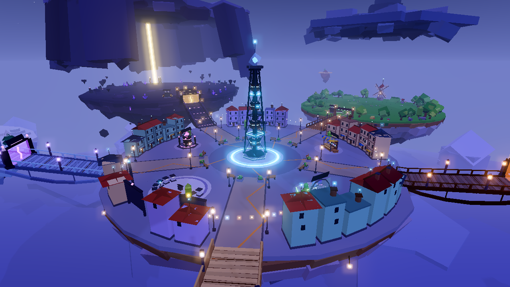
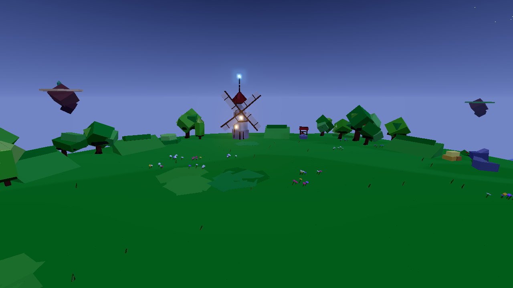
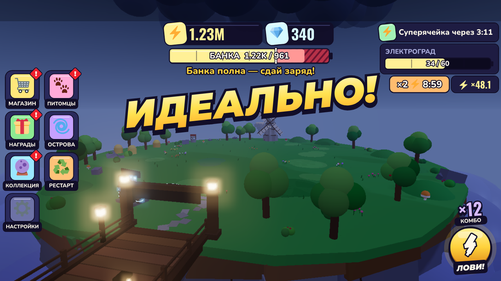
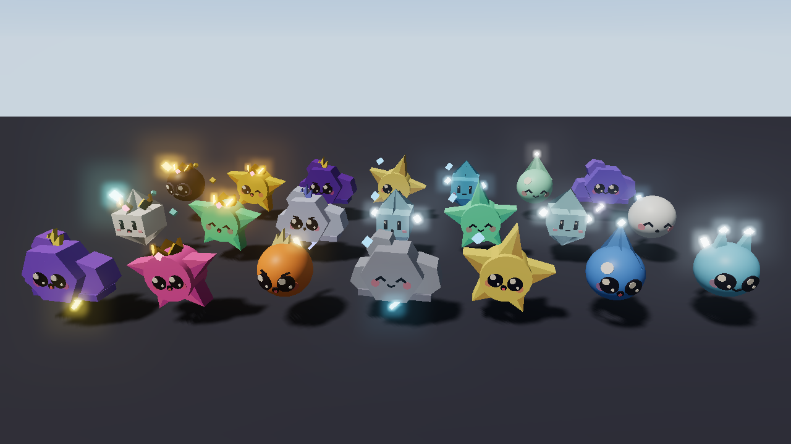

# ⚡ Ловцы Молний (Roblox)



Над летающими островами бесконечная гроза, и молния здесь — сокровище.
На земле вспыхивают кольца там, куда сейчас ударит молния. Вбегаешь в кольцо и жмёшь **⚡ ЛОВИ!**
ровно в момент удара. Идеально — двойной заряд и комбо (звук с каждой поимкой выше).
Ошибся — смешной удар током, волосы дыбом.

Заряд копится в светящейся банке за спиной, банку сдаёшь на подстанции за ⚡ Вольты,
Вольты тратишь на улучшения и новые острова. Весь сервер вместе зажигает город Электроград.

Это симулятор с навыком: каждую секунду нужно выбрать кольцо, добежать и попасть в момент удара.
Просто кликать не получится.

## Как открыть

1. Скачай файл **[`LightningCatchers.rbxl`](LightningCatchers.rbxl)** из этой папки.
2. Открой его в **Roblox Studio** (File → Open from File).
3. Нажми **Play** (F5). Карту видно и без запуска.

> Сохранения работают только в опубликованной игре. В неопубликованном файле игра
> автоматически работает **без сохранений**, это нормально, ошибок не будет.
> Чтобы включить сохранения: File → Publish to Roblox, затем
> *Game Settings → Security → Enable Studio Access to API Services*.

### Публикация

- *Game Settings → Places → Server Size*: **10–12** игроков.
- Иконка и обложка уже готовы: [`art/icon_512.png`](art/icon_512.png) и [`art/thumbnail_1920x1080.png`](art/thumbnail_1920x1080.png)
  (*Game Settings → Basic Info* и страница игры на сайте).
- Коды для игроков: `МОЛНИЯ` (+50 💎), `ПЕРУН` (×2 Вольт на 10 минут), `ГРОЗА` (бесплатный кокон).



## Как играть

| Действие | Телефон | ПК | Геймпад |
|---|---|---|---|
| Ловить молнию | кнопка **⚡ ЛОВИ!** справа внизу | `E` или левый клик | `R2` / `R1` |
| Бег, прыжок | джойстик, кнопка прыжка | `WASD`, `Пробел` | стик, `A` |
| Магазин, питомцы, коллекция, острова, награды | кнопки слева (на телефоне ещё «➕ Ещё») | кнопки слева | кнопки |
| Киоски в хабе | подойти и нажать подсказку | `E` | `X` |

1. Встань в светящееся кольцо. Внешнее кольцо сжимается и в момент удара касается внутреннего: в этот момент жми **⚡**.
2. **ИДЕАЛЬНО** (±120 мс): заряд ×2 и +1 к комбо. **ХОРОШО** (±260 мс): заряд ×1. **МИМО**: удар потерян.
   С 2-го острова за ошибку бьёт током. Вне кольца молния бьёт в землю и оставляет 💎 осколок, его можно подобрать.
3. Банка полна, значит пора на **подстанцию**: у каждого острова своя, ещё одна вокруг Тесла-башни в хабе.
4. Вольты идут на улучшения и новые острова. Осколки — на коконы с питомцами.

## Что есть в игре

- **5 летающих островов**: Грозовой Луг → Медные Холмы → Стеклянные Дюны → Ледяной Пик → Око Бури.
  У каждого своё небо, ориентир, цвета и типы молний: двойные, «вилка» с ритмом, обманка, бегущее кольцо.
- **7 цветов молний**: голубая, фиолетовая, изумрудная, алая, золотая, радужная и Чёрная молния Перуна (~1 из 6000).
  5% колец «переливаются» в более редкий цвет прямо на глазах.
- **Перегрузка банки** до 150%: сверх 100% заряд дороже ×1.5, но банка может лопнуть. Риск всегда виден.
- **Улучшения**: Громоотвод, Банка, Сапоги-скороходы, Грозовой магнит, Изоляция и Тесла-дрон (сам сдаёт банку).
- **21 питомец-искрёнок** с мордочками из 3 коконов, редкости от обычной до мифической, видимые шансы и гарантия легендарного.
- **Фульгуриты**: стеклянные скульптуры, которые оставляет молния. Каждый уникален и имеет свой номер, лучший стоит в галерее хаба.
- **Молниедекс**: коллекция «остров × цвет», за каждую собранную строку +10% Вольт навсегда.
- **События сервера**: Суперячейка (молнии чаще и дороже), Шаровая молния (босс для всех), Радужная молния, Чёрная молния Перуна.
- **Электроград**: от продаж всех игроков кварталы загораются волной, полный город даёт ×2 Вольт на 5 минут всем.
- **Перезапуск генератора** (перерождение): множитель навсегда, питомцы, фульгуриты, Молниедекс и дрон остаются.
- **Каждый день**: календарь на 7 дней (один пропуск прощается), 3 задания, доход пока тебя нет (до 8 часов), бонус за друзей на сервере, таблица лидеров.

### Баланс (симуляция `tools/tests/balance.luau`)

| | Слабый игрок | Средний | Сильный |
|---|---|---|---|
| Остров 2 | ~10 мин | ~5 мин | ~4 мин |
| Остров 3 | ~38 мин | ~19 мин | ~12 мин |
| Остров 4 | ~99 мин | ~51 мин | ~36 мин |
| Перезапуск доступен | ~2.5 ч | ~1.5 ч | ~1 ч |

## Визуальный стиль

Свой стиль «уютный мир под колючей грозой» ([`docs/STYLE.md`](docs/STYLE.md)) вместо типичного «шарики на шариках»:

- **Мир гранёный**: деревья из наклонённых масс с плоским тёмным брюхом, ели из настоящих пирамид,
  тучи — угловатые плиты и свисающие клубы, море облаков внизу — шестигранные купола. Шаров на всей карте 9 (было больше тысячи).
- **Энергия рисуется зигзагом**: хвосты, трещины, дождик под тучкой, значки цветов молний.
- **Надписи** — свои шрифты с полной кириллицей: Montserrat Black Italic для заголовков и оценок (наклон = «удар молнии»),
  Oswald для чисел, Nunito для текста. Интерфейс в стиле «электро-наклеек»: скошенные плашки, двойная обводка, жёсткая тень.
- **Питомцы** — пять разных силуэтов (мочи-искра, гранёная тучка, звезда-печенька, капелька, самоцвет), различимы даже залитые одним цветом.

## Скриншоты (офлайн-рендер, в Roblox освещение и материалы будут чуть другими)

 
 

До и после редизайна: [`docs/screens/redesign/`](docs/screens/redesign/) (файлы `*_before.png` и `*_after.png`).

## Где что менять

- **Все числа** (баланс, цены, острова, молнии, события, награды, коды): `src/shared/Config.luau`
- **Звуки** (проверенные публичные ID Roblox / ProSoundEffects / APM): `src/shared/SoundIds.luau`
- **Питомцы и коконы**: `src/shared/Pets.luau`
- **Карта** генерируется скриптом `tools/gen_map.luau` (+ `tools/map/*`), не правь `src/map/Map.rbxmx` руками.
- **Тексты и языки (EN/RU)**: игра английская по умолчанию, русская — по локали Roblox или в настройках. В коде строки пишутся
  по-русски внутри `Loc.t(...)` (на сервере `Loc.msg(...)`), английские переводы — в словарях `src/shared/Strings/*.luau`
  (глоссарий терминов — `Strings/Shared.luau`). После правок: `python3 tools/check_loc.py`. Подробно — раздел «Локализация»
  в [`docs/ARCHITECTURE.md`](docs/ARCHITECTURE.md).
- Дизайн игры: [`docs/DESIGN.md`](docs/DESIGN.md), устройство кода: [`docs/ARCHITECTURE.md`](docs/ARCHITECTURE.md).

## Что проверено

Roblox нельзя запустить вне Studio, поэтому качество проверялось так:

- **Строгий анализ типов** всего кода (`luau-lsp`, `--!strict`, типы Roblox API): 0 ошибок.
- **Юнит-тесты** чистой логики (оценка нажатия, экономика, питомцы, фульгуриты, геометрия, сохранения) и серверной логики,
  плюс **серверная симуляция** (~200 проверок).
- **Эмулятор Roblox** (`tools/sim`): запускает настоящий серверный и клиентский код, виртуальные игроки на ПК и телефоне
  12 игровых минут ловят молнии, сдают банку, покупают, вылупляют питомцев, переживают события, перерождаются, выходят и заходят снова.
  Каждое свойство и метод сверяются с API Roblox. Результат: **0 ошибок**. Сам эмулятор проверен на 26 видах подброшенных ошибок.
- **Симуляция баланса** для трёх уровней игрока.
- **3D-превью** карты, моделей, интерфейса и иконки (`tools/preview`), чтобы видеть результат.
- **Звуки** проверены через API Roblox: публичные, прошли модерацию, измерены длина, громкость и тишина в начале.
- **Два раунда ревью** кода с разных сторон (сервер, клиент, интерфейс, контракты, ощущения игрока) с проверкой и исправлением находок.

## Сборка из исходников

```bash
tools/setup.sh   # скачать Rojo, Lune, luau-lsp в .tools/
tools/build.sh   # карта -> тесты -> баланс -> анализ -> локализация -> проверка UI -> LightningCatchers.rbxl -> проверка места
.tools/rojo build default.project.json -o /tmp/place.rbxl && .tools/lune run tools/sim/run.luau /tmp/place.rbxl core   # эмулятор
```
